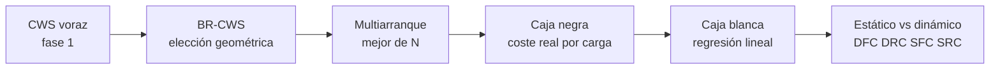

# Learnheuristics en el VRP con entradas dinámicas

Arnau, Juan y Serra (2018). *On the Use of Learnheuristics in Vehicle Routing Optimization Problems with Dynamic Inputs*. Algorithms 11(12), 208. doi:10.3390/a11120208 — copia en [`paper.pdf`](paper.pdf).

Esta carpeta va por fases:

- **Fase 1 (hecha):** CVRP clásico con Clarke & Wright voraz.
- **Fase 2 (hecha):** BR-CWS, la misma construcción con elección geométrica, dentro de un multiarranque.
- **Fase 3 (hecha):** la learnheuristic del paper (caja negra + caja blanca + BR-CWS dinámico), con dos mejoras propias, y el experimento de la Tabla 1, estático frente a dinámico.

## El paper en un esquema

| Pieza | Qué es en el paper |
|---|---|
| Problema base | CVRP: depósito 0, clientes con demanda `d_i`, flota homogénea de capacidad `Q`, coste `c_ij` simétrico. Minimizar coste total |
| Lo dinámico | El coste real de una arista depende de la carga con la que sale el vehículo: se conoce solo al terminar la ruta |
| Caja negra (BB) | `c'_ij = c_ij · (1/2 + Q_ik / C + e)`, `e ~ U[-10⁻³, 10⁻³]`, `Q_ik` = carga al salir de `i` en la ruta `k`. Corrección entre ×½ (vacío) y ×1½ (lleno) |
| Caja blanca (WB) | Regresión lineal que aprende la BB con las rutas que se van completando y predice el coste de las rutas candidatas |
| Heurística constructiva | **BR-CWS**: CWS con elección aleatoria sesgada (geométrica, `p ∈ (0,1; 0,3)`) en la lista de ahorros |
| Metaheurística | Multiarranque: construir muchas soluciones BR-CWS y quedarse con la mejor |
| Ahorros dinámicos | En la versión dinámica la lista se recalcula tras cada unión: `s = coste real(Ri) + coste real(Rj) − coste predicho(Ri+Rj)`. Puede ser negativo (aquí esas uniones se descartan) |
| Comparación | Estático (ignora la BB al construir) frente a dinámico (usa la WB). Métricas: DFC, DRC, SFC, SRC (Dynamic/Static × Forecasted/Real Cost) |
| Resultado | SRC queda de media un **12 %** por encima de DRC; DFC ≈ DRC (la WB aprende enseguida porque la BB es lineal) |

Orden de construcción previsto:



## Datos

Las 30 instancias de la Tabla 1 del paper (conjuntos A, B, E, F, M, P de CVRPLIB, <https://galgos.inf.puc-rio.br/cvrplib>), ya descargadas en `data/`:

- `data/<nombre>.vrp`: instancia en formato TSPLIB (coordenadas, demandas, capacidad).
- `data/<nombre>.sol`: mejor solución conocida (BKS): rutas y coste.

Distancias: euclídeas **sin redondear**, como en el paper (los costes de su Tabla 1 tienen decimales: SFC de A-n32-k5 = 816,73). Las BKS de CVRPLIB usan la euclídea redondeada al entero (`EUC_2D` de TSPLIB), así que ya no se comparan con ellas.

## Estructura

| Ruta | Para qué sirve |
|---|---|
| `main.py` | Experimento de la Tabla 1: para cada instancia, enfoque estático y dinámico; comprueba, guarda CSV y figuras |
| `src/utils/cvrplib.py` | Lista de instancias del paper, lectura de `.vrp` y `.sol` |
| `src/utils/output.py` | Escritura del CSV y dibujo de rutas |
| `src/utils/biased_random.py` | `geometric_index`: posición aleatoria con distribución geométrica (BR-CWS) |
| `src/vrp_objects.py` | Clases `Node`, `Edge`, `Route` y `Solution` de las transparencias de CWS (`vrp_objects.py`) |
| `src/cws.py` | Piezas comunes de CWS con esas clases (nodos y arcos, ahorros, solución dummy, unión de rutas, arcos y cargas de una ruta) y comprobación de factibilidad |
| `src/static/g_cws.py` | CWS voraz: `build_vrp_sol` (Algorithm 1) cogiendo siempre la mejor arista. `python -m src.static.g_cws A-n80-k10` imprime la solución como en las transparencias |
| `src/static/br_cws.py` | BR-CWS: su propio `build_vrp_sol` con elección geométrica y el multiarranque `multi_start`. Es el enfoque estático |
| `src/dynamic/d_br_cws.py` | D-BR-CWS, nuestra learnheuristic: Algorithms 1 y 2 del paper, con caja negra y caja blanca, los dos sentidos de unión y búsqueda local 2-opt. Es el enfoque dinámico |
| `src/dynamic/d_br_cws_numba.py` | La misma learnheuristic acelerada con numba: mismos resultados |
| `src/dynamic/black_box.py` | Caja negra: ecuación (2), el coste real de una ruta |
| `src/dynamic/white_box.py` | Caja blanca: regresión lineal (`LinearRegression` de scikit-learn, sin término independiente) que aprende de la caja negra |
| `data/` | Instancias y BKS de CVRPLIB |
| `results/learnheuristic.csv` | Una fila por instancia, con las columnas de la Tabla 1 y los tiempos con y sin numba |
| `results/comparison_paper.csv` | Nuestros DFC, DRC, SRC y SFC junto a los de la Tabla 1 del paper |
| `figures/static/`, `figures/dynamic/` | Rutas de la mejor solución de cada enfoque |
| `figures/plots/` | Gap SRC frente a DRC (paper y nuestro) y gap frente a la BKS |

## Cómo se ejecuta

Todos los proyectos de `work-papers/` comparten el entorno `work-papers/.venv`. Desde esta carpeta:

```bash
source ../.venv/bin/activate
uv pip install -r requirements.txt   # solo la primera vez o si cambian las dependencias
python main.py                       # las 30
python main.py A-n32-k5 E-n51-k5     # solo algunas
```

## CWS clásico

Construcción de las transparencias de CWS (`cws_heuristic.py`, A. A. Juan) con las clases `Node`, `Edge`, `Route` y `Solution` de `src/vrp_objects.py`, ordenada como los Algorithm 1 y 2 del paper quitando la caja negra y la caja blanca. Las piezas comunes están en `src/cws.py`; el bucle del Algorithm 1 voraz, en `src/static/g_cws.py`:

| Paper | Código | Qué hace |
|---|---|---|
| `BUILDDVRPSOL` (Alg. 1) | `g_cws.build_vrp_sol(inst)` | Bucle principal |
| (lectura de nodos y arcos) | `vrp_objects.create_nodes_and_edges(inst)` | Un `Node` por fila con sus `Edge` depósito → nodo (`dn_edge`) y nodo → depósito (`nd_edge`); un `Edge` por pareja `i < j` (con su inverso), con coste y `s_ij = c_0i + c_0j − c_ij`, en `edges[i, j]` |
| `COMPUTESAVINGS` (Alg. 2) | `compute_savings(edges)` | `Savings`: filas `(i, j, s_ij)` en orden decreciente de ahorro. Es la misma lista que usan BR-CWS y D-BR-CWS |
| `generateBaseSolution` | `generate_base_solution(nodes)` | Solución dummy: una `Route` por cliente, `0 → i → 0` |
| `index ← generate random number` + `get edge` + `delete edge` | `edges[savings.get(0)]` + `savings.delete(0)` | Voraz: siempre la mejor arista que queda |
| `mergeFeasible(edge)` | `merge_feasible(edge, capacity)` | `checkMergingConditions`: rutas distintas, `i` y `j` exteriores (`is_interior`), demanda conjunta `≤ Q` |
| `mergeRoutes(edge, solution)` | `merge_routes(edge, solution)` | Orienta las rutas como `0 … i → 0` y `0 → j … 0` (`Route.reverse`), quita esos dos arcos al depósito y une `0 … i \| j … 0` |

Comprobación: el voraz da 1860,94 en A-n80-k10, con las mismas rutas que las transparencias, y reproduce los costes CWS de la tabla del JORS (A-n32-k5 843,69; A-n65-k9 1239,42…).

Las líneas 11-14 del Algorithm 1 (coste real, caja blanca y recálculo de ahorros) no existen en la versión clásica: el coste de una ruta es su distancia y la lista de ahorros no cambia.

## BR-CWS

`src/static/br_cws.py` tiene dos bucles:

1. **`br_cws.build_vrp_sol(inst, p, rng)`** construye una solución. Es el mismo Algorithm 1 que `g_cws.build_vrp_sol` y usa las mismas piezas de `cws.py`; solo cambia la línea 5. Por cada arista que saca, pide un número aleatorio `u` y lo convierte en posición con `geometric_index`: `int(log(1 − u) / log(1 − p)) % k`. La posición `k` sale con probabilidad proporcional a `p (1 − p)^k`: con `p → 1` se recupera el voraz y con `p → 0`, una elección uniforme.
2. **`multi_start(inst, p, n_iter, seed)`** es el multiarranque de la sección 4.1. Crea un generador con la semilla y llama `n_iter` veces a `br_cws.build_vrp_sol`. El generador avanza en cada llamada, así que cada iteración recibe números aleatorios distintos y construye otra solución. Empieza con la voraz y devuelve la mejor, así que nunca sale peor que CWS.

Referencia frente a la BKS, con la versión anterior de `main.py`: el voraz queda a un 4,86 % de media y BR-CWS (`p = 0,2`, 500 iteraciones, semilla 0) a un 2,02 %. Con distancias enteras hay muchos ahorros empatados; la ordenación es estable, así que entre empates va primero la pareja `(i, j)` de índices más bajos.

## Learnheuristic (D-BR-CWS)

`src/dynamic/d_br_cws.py` sigue los Algorithms 1 y 2 del paper línea a línea (los comentarios llevan el número de línea) y les añade dos cosas que el paper no tiene (abajo). El Algorithm 1 es literal, incluidos `delete edge` (línea 7) y el `if mergeFeasible` (línea 8). El Algorithm 2 hace las mismas cuentas con los nombres del paper (`exterior_nodes`, `i_real_cost`, `merged_predicted_cost`, `route_savings`), pero calcula todas las parejas a la vez con numpy en lugar de con dos bucles:

| Paper | Código | Qué hace |
|---|---|---|
| `BUILDDVRPSOL` (Alg. 1) | `d_br_cws.build_vrp_sol(inst, p, rng, black_box, white_box)` | Construye una solución |
| `generateBaseSolution(inputs)` (l. 2) | `d_br_cws.generate_base_solution(nodes, black_box)` | Solución dummy `0 → i → 0`, con el coste real de cada ruta (lo que lee `getCost ▷ Black Box` en Alg. 2) |
| `blackBox.getRealCost(route)` (l. 11) | `BlackBox.get_real_cost(route)` | `Σ c_e (1/2 + Q_e / C + ϵ)`, con `ϵ ~ U[−10⁻³, 10⁻³]` nuevo en cada arco y llamada |
| `solution.update(realCost)` (l. 12) | `Solution.update(route, real_cost)` | El coste de la ruta pasa a ser el real |
| `whiteBox.update(route, realCost)` (l. 13) | `WhiteBox.update(dist, w, real_cost)` | Añade una observación y reajusta la regresión |
| `computeSavings(solution, whiteBox)` (Alg. 2, l. 3 y 14) | `d_br_cws.compute_savings(solution, white_box)` | `coste real(A) + coste real(B) − predicción(ruta unida)` para cada pareja de nodos exteriores, en el sentido más barato; la lista guarda el arco en ese sentido y su `Edge` se busca al sacarlo (línea 6) |
| `mergeRoutes(iRoute, jRoute)` + `whiteBox.predictCost(mergedRoute)` (Alg. 2, l. 8 y 11) | `d_br_cws.merge_routes(i_route, j_route)` + `WhiteBox.predict_cost(dist, w)` | `b0 · Σ c_e + b1 · Σ c_e Q_e / C` de la ruta unida, sin construirla |
| — | `d_br_cws.local_search(solution, edges, black_box, white_box)` | 2-opt en cada ruta al acabar la construcción |
| Multiarranque (4.1) | `d_br_cws.multi_start(...)` | La mejor por coste real de `n_iter` construcciones; la caja blanca sigue aprendiendo entre ellas |

Decisiones donde el paper no entra en detalle:

- **Carga `Q_e`.** Es reparto: el vehículo sale lleno con la carga de la ruta, deja la demanda en cada cliente y vuelve vacío. Se define en un solo sitio, `cws.edge_loads(route)`, que usan la caja negra y la caja blanca (`d_br_cws.route_features`). Por eso recorrer una ruta en un sentido o en el otro no cuesta lo mismo.
- **Sentido de la unión.** Con costes que dependen de la carga, `… i | j …` y `… j | i …` cuestan distinto. El paper predice una sola ruta unida por pareja; aquí se predicen las dos (abajo).
- **Variables de la caja blanca.** El paper se queda con la carga y la capacidad. Aquí entran como `Q_e / C` en cada arco, ponderadas por su coste medio: `coste ≈ b0 · Σ c_e + b1 · Σ c_e Q_e / C`. Los valores verdaderos son `b0 = 1/2` y `b1 = 1`, y la regresión los encuentra (columnas `wb_b0`, `wb_b1`).
- **Datos de la caja blanca.** Como en el Algorithm 1, solo aprende de las rutas unidas (línea 13); las `0 → i → 0` de la solución base no son observaciones. Deja de actualizarse a las 500 observaciones (sección 5.2). Antes de tener datos (al empezar la primera construcción del multiarranque) predice la distancia.
- **Ahorros.** Solo se guardan los positivos, como en CWS clásico (el paper los guarda todos). Las uniones no factibles se quedan en la lista y las descarta la línea 8 del Algorithm 1, como en el paper.
- **Rapidez.** Algorithm 2 sigue el paper línea a línea, pero sin los dos bucles: `get_exterior_nodes` devuelve los `Node` extremos de ruta, `Routes.of` pasa sus `node.in_route` a columnas (carga, coste real, `Σ c_e` y `Σ c_e Q_e` en los dos sentidos), `get_route` da `i_route`/`j_route` en las posiciones de cada pareja, y `merge_routes` da `(Σ c_e, Σ c_e Q_e)` de la ruta unida en O(1) por pareja. Numpy hace todas las parejas a la vez.

### Lo que añadimos al paper

| | Paper | Nuestro |
|---|---|---|
| Algorithm 2 | Predice una ruta unida por pareja, `… i \| j …` | Predice `… i \| j …` y `… j \| i …` (la misma ruta al revés: `Σ c_e Q'_e = Q · Σ c_e − Σ c_e Q_e`) y guarda el ahorro del sentido más barato. La lista guarda el arco en ese sentido (`i → j` o `j → i`) y `cws.merge_routes` deja la ruta así |
| Después de construir | Nada | `local_search`: 2-opt con mejor mejora en cada ruta, según el coste que predice la caja blanca, hasta que ningún movimiento lo baja. Invertir la ruta entera cuenta como movimiento. La caja negra revela el coste real de las rutas que cambian (`solution.update`) y la caja blanca aprende de ellas |

La búsqueda local usa la caja blanca y no la negra porque, como en el paper, el coste real solo se conoce al ejecutar la ruta; con `DFC ≈ DRC` la predicción basta para elegir. Más detalle del 2-opt en [`notes.md`](notes.md).

### Con numba

`src/dynamic/d_br_cws_numba.py` da las mismas soluciones (mismo DRC con las mismas semillas) y cambia solo cómo se calcula:

- **Algorithm 2** (~70 % del tiempo) en un bucle compilado (`_savings`) sobre las parejas, sin arrays intermedios, y con la predicción `b0 · Σ c_e + b1 · Σ c_e Q_e / C` hecha con `white_box.beta` en lugar de `LinearRegression.predict`, que valida la entrada en cada llamada.
- **2-opt** compilado (`_two_opt`) sobre una matriz de costes, sin construir cada ruta candidata.
- **Nodos y arcos** se crean una vez por multiarranque, no en cada construcción.

Lo que queda es Python: el ajuste de la caja blanca (scikit-learn, hasta 500 veces por semilla; es casi todo el tiempo en las instancias pequeñas), `Routes.of` y la lista de ahorros, que se reconstruye y se ordena entera tras cada unión. Tiempos en [Resultados](#con-y-sin-numba).

## Experimento (Tabla 1)

Por cada instancia y semilla, con el mismo `p` y el mismo número de construcciones:

- **Estático:** `br_cws.multi_start` con distancias. Su coste previsto es la distancia (SFC); la caja negra revela el real (SRC). Entre semillas se queda la de menor SFC, que es lo único que ve este enfoque.
- **Dinámico:** `d_br_cws.multi_start`. Coste real (DRC) y el que predice la caja blanca al final (DFC). Entre semillas se queda la de menor DRC.
- **Dinámico con numba:** `d_br_cws_numba.multi_start` con las mismas semillas, solo para medir el tiempo (`drc_numba` debe ser igual al DRC).

Gaps respecto al DRC, como en el paper. Parámetros en `main.py`: `P = 0.2`, `N_ITER = 100` construcciones por semilla y 5 semillas (`SEEDS = range(5)`; el paper usa 30). El paper no dice cuántas construcciones.

## Resultados

`results/learnheuristic.csv`, con 5 semillas. Ejecución completa: unos 15 min (estático 114 s, dinámico 504 s, dinámico con numba 249 s; M-n200-k16: 158 s y 106 s). `results/comparison_paper.csv` pone al lado los valores de la Tabla 1 del paper, con sus gaps recalculados a partir de los costes.

### Nuestros resultados por instancia

Mejor solución de cada enfoque entre las 5 semillas. Gaps respecto al DRC, como en la Tabla 1; `b0`, `b1` son los coeficientes de la caja blanca al final (valores verdaderos 0,5 y 1). Tiempos de las 5 semillas × 100 construcciones.

| Instancia | Clientes | C | DFC | DRC | SRC | SFC | Rutas din. / est. | Gap DFC (%) | Gap SRC (%) | Gap SFC (%) | b0 | b1 | t estático (s) | t dinámico (s) |
|---|---:|---:|---:|---:|---:|---:|:---:|---:|---:|---:|---:|---:|---:|---:|
| A-n32-k5 | 31 | 100 | 695,99 | 696,00 | 804,88 | 797,72 | 5 / 5 | -0,00 | 15,64 | 14,61 | 0,5 | 1,0001 | 0,33 | 4,06 |
| A-n38-k5 | 37 | 100 | 633,85 | 633,87 | 750,24 | 742,14 | 6 / 5 | -0,00 | 18,36 | 17,08 | 0,5 | 1,0 | 0,48 | 4,91 |
| A-n55-k9 | 54 | 100 | 981,90 | 981,93 | 1076,54 | 1097,80 | 10 / 9 | -0,00 | 9,64 | 11,80 | 0,5 | 0,9998 | 1,24 | 7,72 |
| A-n60-k9 | 59 | 100 | 1250,54 | 1250,78 | 1347,85 | 1378,15 | 10 / 9 | -0,02 | 7,76 | 10,18 | 0,5001 | 0,9999 | 1,58 | 9,99 |
| A-n61-k9 | 60 | 100 | 954,33 | 954,35 | 1042,90 | 1049,37 | 11 / 10 | -0,00 | 9,28 | 9,96 | 0,5 | 1,0 | 1,77 | 9,59 |
| A-n65-k9 | 64 | 100 | 1091,97 | 1091,86 | 1176,38 | 1197,52 | 9 / 9 | 0,01 | 7,74 | 9,68 | 0,4999 | 1,0003 | 1,97 | 10,90 |
| A-n80-k10 | 79 | 100 | 1664,10 | 1664,08 | 1804,56 | 1808,58 | 11 / 10 | 0,00 | 8,44 | 8,68 | 0,4999 | 1,0002 | 3,59 | 19,17 |
| B-n35-k5 | 34 | 100 | 856,15 | 855,97 | 916,92 | 971,90 | 6 / 5 | 0,02 | 7,12 | 13,54 | 0,5 | 1,0 | 0,39 | 5,03 |
| B-n50-k7 | 49 | 100 | 669,75 | 669,78 | 717,96 | 748,80 | 8 / 7 | -0,01 | 7,19 | 11,80 | 0,5 | 1,0001 | 1,02 | 7,21 |
| B-n52-k7 | 51 | 100 | 671,74 | 671,66 | 765,98 | 761,13 | 7 / 7 | 0,01 | 14,04 | 13,32 | 0,5 | 1,0001 | 1,15 | 8,23 |
| B-n64-k9 | 63 | 100 | 815,05 | 814,88 | 852,13 | 896,60 | 10 / 10 | 0,02 | 4,57 | 10,03 | 0,5 | 1,0001 | 1,89 | 10,96 |
| B-n67-k10 | 66 | 100 | 963,99 | 963,75 | 1032,75 | 1083,53 | 11 / 10 | 0,02 | 7,16 | 12,43 | 0,5001 | 0,9998 | 2,06 | 11,26 |
| B-n78-k10 | 77 | 100 | 1141,32 | 1141,41 | 1246,99 | 1263,43 | 11 / 10 | -0,01 | 9,25 | 10,69 | 0,5001 | 0,9997 | 3,46 | 17,22 |
| E-n101-k14 | 100 | 112 | 993,82 | 993,85 | 1090,01 | 1132,33 | 15 / 14 | -0,00 | 9,68 | 13,93 | 0,5 | 0,9999 | 7,46 | 26,32 |
| E-n22-k4 | 21 | 6000 | 334,03 | 334,00 | 386,28 | 377,26 | 4 / 4 | 0,01 | 15,65 | 12,95 | 0,5 | 1,0001 | 0,14 | 2,49 |
| E-n23-k3 | 22 | 4500 | 434,82 | 434,66 | 463,94 | 568,56 | 3 / 3 | 0,04 | 6,73 | 30,81 | 0,5 | 1,0001 | 0,16 | 2,88 |
| E-n30-k3 | 29 | 4500 | 418,91 | 418,89 | 462,85 | 508,37 | 4 / 4 | 0,01 | 10,50 | 21,36 | 0,5 | 1,0001 | 0,33 | 4,28 |
| E-n33-k4 | 32 | 8000 | 771,20 | 771,15 | 805,77 | 841,13 | 4 / 4 | 0,01 | 4,49 | 9,07 | 0,5 | 1,0001 | 0,38 | 4,61 |
| E-n51-k5 | 50 | 160 | 473,54 | 473,53 | 544,45 | 558,05 | 6 / 5 | 0,00 | 14,98 | 17,85 | 0,5 | 0,9998 | 1,09 | 7,32 |
| E-n76-k10 | 75 | 140 | 759,67 | 759,58 | 884,47 | 860,06 | 11 / 10 | 0,01 | 16,44 | 13,23 | 0,5 | 0,9999 | 3,04 | 14,36 |
| E-n76-k14 | 75 | 100 | 925,87 | 925,86 | 1023,32 | 1049,07 | 16 / 15 | 0,00 | 10,53 | 13,31 | 0,5001 | 0,9997 | 3,16 | 14,24 |
| F-n135-k7 | 134 | 2210 | 1060,36 | 1060,34 | 1168,47 | 1203,19 | 9 / 7 | 0,00 | 10,20 | 13,47 | 0,5 | 1,0001 | 15,99 | 70,77 |
| M-n101-k10 | 100 | 200 | 760,85 | 760,78 | 810,71 | 833,51 | 10 / 10 | 0,01 | 6,56 | 9,56 | 0,5 | 1,0 | 7,04 | 27,47 |
| M-n200-k16 | 199 | 200 | 1202,20 | 1202,22 | 1349,81 | 1368,07 | 18 / 17 | -0,00 | 12,28 | 13,80 | 0,5 | 1,0001 | 46,32 | 157,57 |
| P-n22-k8 | 21 | 3000 | 533,60 | 533,57 | 561,98 | 588,79 | 9 / 9 | 0,01 | 5,33 | 10,35 | 0,5 | 0,9999 | 0,15 | 2,23 |
| P-n40-k5 | 39 | 140 | 403,20 | 403,26 | 475,62 | 481,81 | 6 / 5 | -0,02 | 17,94 | 19,48 | 0,5 | 1,0002 | 0,64 | 5,05 |
| P-n50-k10 | 49 | 100 | 624,64 | 624,60 | 687,86 | 715,82 | 11 / 11 | 0,01 | 10,13 | 14,60 | 0,5 | 1,0002 | 1,11 | 6,75 |
| P-n55-k15 | 54 | 70 | 859,55 | 859,64 | 933,05 | 962,54 | 17 / 16 | -0,01 | 8,54 | 11,97 | 0,4999 | 1,0004 | 1,25 | 7,48 |
| P-n65-k10 | 64 | 130 | 721,24 | 721,31 | 801,05 | 817,60 | 11 / 10 | -0,01 | 11,05 | 13,35 | 0,4999 | 1,0002 | 2,00 | 11,49 |
| P-n70-k10 | 69 | 135 | 750,55 | 750,56 | 832,90 | 849,17 | 12 / 11 | -0,00 | 10,97 | 13,14 | 0,5 | 0,9999 | 2,81 | 12,34 |
| **Media** | | | 813,96 | 813,94 | 893,95 | 917,07 | 9,37 / 8,70 | **0,00** | **10,27** | **13,53** | | | 114,00 (total) | 503,90 (total) |

### Frente al paper

| Gap medio frente a DRC | Nuestro | Paper |
|---|---:|---:|
| DFC | 0,00 % | 0,00 % |
| SRC | 10,27 % | 12,02 % |
| SFC | 13,53 % | −1,50 % |

El −1,50 % del SFC del paper es la media recalculada con sus costes; en el artículo pone −1,25 %.

- **DFC ≈ DRC.** La caja blanca aprende la caja negra casi exacta (`b0 ≈ 0,5`, `b1 ≈ 1`), porque es lineal y con poco ruido. Igual que en el paper.
- **SRC > DRC en las 30 instancias**, de un 4,49 % (E-n33-k4) a un 18,36 % (A-n38-k5); de media un 10,27 %, cerca del 12,02 % del paper. Ignorar la dinámica sale caro.
- **SFC por encima del DRC, al revés que en el paper.** Con la ecuación (2) y `Q` = carga al salir de `i` ya servido, un arco cuesta `1/2 + Q/C` veces su distancia y la carga media por arco queda por debajo de `C/2`: el coste real sale por debajo de la distancia (SRC/SFC entre 0,82 y 1,03). En la Tabla 1 del paper SRC/SFC está entre 1,07 y 1,20, así que su caja negra cobra más; el artículo no da detalle suficiente para saber cómo (orientación de las rutas o definición exacta de `Q`).
- **Costes absolutos.** Nuestro DRC queda de media un 14,7 % por debajo del del paper, sobre todo porque la caja negra cobra menos (punto anterior); los dos sentidos y el 2-opt ponen el resto. Las soluciones dependen además de la semilla y del número de construcciones, así que los costes solo se comparan en orden de magnitud.
- **Rutas.** El dinámico usa más rutas que el estático en 19 instancias y nunca menos. Frente al paper, una ruta más en 18 instancias y una menos en una.

Por instancia (gaps respecto al DRC de cada uno):

| Instancia | DRC paper | DRC nuestro | SRC paper | SRC nuestro | Rutas dinámico paper / nuestro | SRC gap paper (%) | SRC gap nuestro (%) | SFC gap paper (%) | SFC gap nuestro (%) |
|---|---:|---:|---:|---:|:---:|---:|---:|---:|---:|
| A-n32-k5 | 863,05 | 696,00 | 871,49 | 804,88 | 5 / 5 | 0,98 | 15,64 | -5,37 | 14,61 |
| A-n38-k5 | 749,08 | 633,87 | 866,13 | 750,24 | 5 / 6 | 15,63 | 18,36 | 0,94 | 17,08 |
| A-n55-k9 | 1096,97 | 981,93 | 1212,64 | 1076,54 | 9 / 10 | 10,54 | 9,64 | 1,28 | 11,80 |
| A-n60-k9 | 1404,75 | 1250,78 | 1532,85 | 1347,85 | 9 / 10 | 9,12 | 7,76 | -1,65 | 10,18 |
| A-n61-k9 | 1089,57 | 954,35 | 1256,55 | 1042,90 | 10 / 11 | 15,33 | 9,28 | 0,67 | 9,96 |
| A-n65-k9 | 1256,14 | 1091,86 | 1455,82 | 1176,38 | 10 / 9 | 15,90 | 7,74 | -0,69 | 9,68 |
| A-n80-k10 | 1832,10 | 1664,08 | 2133,16 | 1804,56 | 10 / 11 | 16,43 | 8,44 | -0,17 | 8,68 |
| B-n35-k5 | 1040,42 | 855,97 | 1215,04 | 916,92 | 5 / 6 | 16,78 | 7,12 | -3,03 | 13,54 |
| B-n50-k7 | 758,12 | 669,78 | 880,08 | 717,96 | 7 / 8 | 16,09 | 7,19 | -0,92 | 11,80 |
| B-n52-k7 | 750,90 | 671,66 | 842,10 | 765,98 | 7 / 7 | 12,15 | 14,04 | 1,71 | 13,32 |
| B-n64-k9 | 930,40 | 814,88 | 1025,43 | 852,13 | 10 / 10 | 10,21 | 4,57 | -1,78 | 10,03 |
| B-n67-k10 | 1040,37 | 963,75 | 1285,71 | 1032,75 | 10 / 11 | 23,58 | 7,16 | 5,30 | 12,43 |
| B-n78-k10 | 1272,61 | 1141,41 | 1506,71 | 1246,99 | 10 / 11 | 18,40 | 9,25 | 0,49 | 10,69 |
| E-n101-k14 | 1155,55 | 993,85 | 1316,35 | 1090,01 | 14 / 15 | 13,92 | 9,68 | -1,04 | 13,93 |
| E-n22-k4 | 378,27 | 334,00 | 431,31 | 386,28 | 4 / 4 | 14,02 | 15,65 | 2,78 | 12,95 |
| E-n23-k3 | 639,43 | 434,66 | 653,12 | 463,94 | 3 / 3 | 2,14 | 6,74 | -10,47 | 30,81 |
| E-n30-k3 | 527,00 | 418,89 | 547,88 | 462,85 | 4 / 4 | 3,96 | 10,49 | -2,82 | 21,36 |
| E-n33-k4 | 876,15 | 771,15 | 910,05 | 805,77 | 4 / 4 | 3,87 | 4,49 | -3,61 | 9,07 |
| E-n51-k5 | 575,67 | 473,53 | 631,93 | 544,45 | 5 / 6 | 9,77 | 14,98 | -0,35 | 17,85 |
| E-n76-k10 | 917,56 | 759,58 | 1017,11 | 884,47 | 11 / 11 | 10,85 | 16,44 | -4,02 | 13,23 |
| E-n76-k14 | 1094,58 | 925,86 | 1255,58 | 1023,32 | 15 / 16 | 14,71 | 10,53 | -2,87 | 13,31 |
| F-n135-k7 | 1255,19 | 1060,34 | 1313,82 | 1168,47 | 7 / 9 | 4,67 | 10,20 | -3,34 | 13,47 |
| M-n101-k10 | 895,96 | 760,78 | 1025,60 | 810,71 | 10 / 10 | 14,47 | 6,56 | -0,23 | 9,56 |
| M-n200-k16 | 1458,34 | 1202,22 | 1599,36 | 1349,81 | 17 / 18 | 9,67 | 12,28 | -5,44 | 13,80 |
| P-n22-k8 | 606,77 | 533,57 | 659,59 | 561,98 | 9 / 9 | 8,71 | 5,32 | -2,86 | 10,35 |
| P-n40-k5 | 514,17 | 403,26 | 556,51 | 475,62 | 5 / 6 | 8,23 | 17,94 | -2,55 | 19,48 |
| P-n50-k10 | 727,61 | 624,60 | 839,86 | 687,86 | 11 / 11 | 15,43 | 10,13 | -1,27 | 14,60 |
| P-n55-k15 | 975,69 | 859,64 | 1164,20 | 933,05 | 16 / 17 | 19,32 | 8,54 | 0,71 | 11,97 |
| P-n65-k10 | 871,10 | 721,31 | 964,59 | 801,05 | 10 / 11 | 10,73 | 11,05 | -4,47 | 13,35 |
| P-n70-k10 | 885,17 | 750,56 | 1018,95 | 832,90 | 11 / 12 | 15,11 | 10,97 | 0,08 | 13,14 |
| **Media** | 947,96 | 813,94 | 1066,32 | 893,95 | | **12,02** | **10,27** | **-1,50** | **13,53** |

### SRC frente a DRC por instancia

`python -m src.utils.plot_gaps` → `figures/plots/src_gap.png` y tabla por instancia. Mismo cálculo que la tabla 1 del paper, `gap = (SRC − DRC) / DRC` por instancia y media de esos gaps.

### Frente a la BKS (comparación dinámica)

`python -m src.utils.plot_bks` → `figures/plots/bks_gap.png`. Las rutas de la BKS de CVRPLIB (`data/*.sol`) pasan por la misma caja negra que nuestras soluciones, cada una en su sentido más barato, y se comparan con el coste real de cada enfoque: `gap = (coste − BKS) / BKS`, negativo = mejor que la BKS. La BKS está optimizada para distancia, no para carga: es una buena referencia, no el óptimo del problema dinámico.

| Gap medio frente al coste real de la BKS | |
|---|---:|
| Estático (SRC) | 6,59 % |
| D-BR-CWS (DRC) | −3,32 % |

- **El dinámico baja del coste real de la BKS en 28 de 30 instancias** (no en B-n67-k10, +0,93 %, ni en E-n22-k4, +0,23 %): tener en cuenta la carga compensa más que partir de las mejores rutas en distancia.
- **El estático queda por encima** en 28 de 30.

### Con y sin numba

Tiempo del dinámico por instancia (5 semillas × 100 construcciones), con y sin numba, ordenado por número de clientes. Las dos versiones dan el mismo DRC en las 30.

| Instancia | Clientes | DRC sin numba | DRC con numba | Sin numba (s) | Con numba (s) | Speedup |
|---|---:|---:|---:|---:|---:|---:|
| E-n22-k4 | 21 | 334,00 | 334,00 | 2,49 | 0,90 | 2,77× |
| P-n22-k8 | 21 | 533,57 | 533,57 | 2,23 | 0,93 | 2,40× |
| E-n23-k3 | 22 | 434,66 | 434,66 | 2,88 | 1,01 | 2,85× |
| E-n30-k3 | 29 | 418,89 | 418,89 | 4,28 | 1,28 | 3,34× |
| A-n32-k5 | 31 | 696,00 | 696,00 | 4,06 | 1,53 | 2,65× |
| E-n33-k4 | 32 | 771,15 | 771,15 | 4,61 | 1,53 | 3,01× |
| B-n35-k5 | 34 | 855,97 | 855,97 | 5,03 | 1,57 | 3,20× |
| A-n38-k5 | 37 | 633,87 | 633,87 | 4,91 | 1,60 | 3,07× |
| P-n40-k5 | 39 | 403,26 | 403,26 | 5,05 | 1,80 | 2,81× |
| B-n50-k7 | 49 | 669,78 | 669,78 | 7,21 | 2,64 | 2,73× |
| P-n50-k10 | 49 | 624,60 | 624,60 | 6,75 | 2,43 | 2,78× |
| E-n51-k5 | 50 | 473,53 | 473,53 | 7,32 | 2,67 | 2,74× |
| B-n52-k7 | 51 | 671,66 | 671,66 | 8,23 | 2,71 | 3,04× |
| A-n55-k9 | 54 | 981,93 | 981,93 | 7,72 | 2,95 | 2,62× |
| P-n55-k15 | 54 | 859,64 | 859,64 | 7,48 | 2,67 | 2,80× |
| A-n60-k9 | 59 | 1250,78 | 1250,78 | 9,99 | 4,06 | 2,46× |
| A-n61-k9 | 60 | 954,35 | 954,35 | 9,59 | 3,67 | 2,61× |
| B-n64-k9 | 63 | 814,88 | 814,88 | 10,96 | 4,29 | 2,55× |
| A-n65-k9 | 64 | 1091,86 | 1091,86 | 10,90 | 4,17 | 2,61× |
| P-n65-k10 | 64 | 721,31 | 721,31 | 11,49 | 4,62 | 2,49× |
| B-n67-k10 | 66 | 963,75 | 963,75 | 11,26 | 4,15 | 2,71× |
| P-n70-k10 | 69 | 750,56 | 750,56 | 12,34 | 5,11 | 2,41× |
| E-n76-k10 | 75 | 759,58 | 759,58 | 14,36 | 5,85 | 2,45× |
| E-n76-k14 | 75 | 925,86 | 925,86 | 14,24 | 5,69 | 2,50× |
| B-n78-k10 | 77 | 1141,41 | 1141,41 | 17,22 | 6,94 | 2,48× |
| A-n80-k10 | 79 | 1664,08 | 1664,08 | 19,17 | 8,54 | 2,24× |
| E-n101-k14 | 100 | 993,85 | 993,85 | 26,32 | 12,55 | 2,10× |
| M-n101-k10 | 100 | 760,78 | 760,78 | 27,47 | 11,98 | 2,29× |
| F-n135-k7 | 134 | 1060,34 | 1060,34 | 70,77 | 33,05 | 2,14× |
| M-n200-k16 | 199 | 1202,22 | 1202,22 | 157,57 | 105,76 | 1,49× |
| **Total** | | | | **503,90** | **248,65** | **2,03×** |

- **2,0× en total** (504 s → 249 s), entre 1,5× (M-n200-k16) y 3,3× (E-n30-k3).
- **El speedup baja con el tamaño.** En las grandes pesa lo que sigue en Python: `Routes.of` y reconstruir y ordenar la lista de ahorros tras cada unión, que crecen con el número de parejas.
