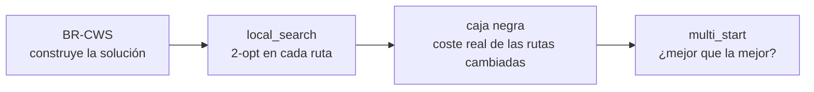

# Búsqueda local y 2-opt

## Búsqueda local

Una búsqueda local parte de una solución ya construida y la mejora con cambios pequeños (*movimientos*):

1. Mira las soluciones *vecinas*, las que salen de aplicar un movimiento a la actual.
2. Si alguna es mejor, pasa a ella.
3. Repite hasta que ninguna vecina mejora: la solución es un **óptimo local** para ese movimiento.

No garantiza el óptimo global. Por eso se combina con una heurística constructiva aleatoria (BR-CWS) dentro de un multiarranque: cada construcción da un punto de partida distinto y la búsqueda local lo pule.

Dos maneras de elegir la vecina:

- **Primera mejora:** se queda con la primera que mejora.
- **Mejor mejora:** las mira todas y se queda con la que más mejora. Es la que usa v2.

## 2-opt

Es el movimiento clásico dentro de una ruta: quitar dos arcos y volver a unir los trozos al revés, lo que equivale a **invertir un tramo** de la ruta.

```
antes:   0 → a → [b → c → d] → e → 0
después: 0 → a → [d → c → b] → e → 0
```

Se quitan `a → b` y `d → e`, y se ponen `a → d` y `b → e`. Si dos arcos de la ruta se cruzan, el 2-opt los descruza.

Con costes que solo dependen de la distancia, el tramo invertido cuesta lo mismo y solo cambian dos arcos. Aquí no: el coste real de un arco depende de la carga con la que se recorre (`c_e (1/2 + Q_e / C)`), y al invertir el tramo cambia la carga de todos sus arcos. Por eso v2 recalcula la ruta entera para cada candidato, y también prueba a invertir la ruta completa (`0 → d → c → b → 0`), que en distancia no cambia nada pero sí en coste real.

## Cómo está en `src/dynamic/d_br_cws_v2.py`

- **`two_opt(route, edges, white_box)`:** para una ruta, genera todos los tramos `[a..b]` que se pueden invertir, calcula `(Σ c_e, Σ c_e Q_e)` de cada candidato y pide a la caja blanca su coste. Aplica el mejor si baja el coste predicho y repite hasta que ninguno lo baja. Devuelve si la ruta ha cambiado.
- **`local_search(solution, edges, black_box, white_box)`:** llama a `two_opt` en cada ruta de la solución. Si la ruta cambia, la caja negra revela su coste real (`solution.update`) y la caja blanca aprende de él (`white_box.update`).
- **`build_vrp_sol`:** llama a `local_search` al final, después de las uniones de BR-CWS. `multi_start` compara con la mejor solución ya mejorada.

La búsqueda local decide con la caja blanca y no con la negra porque, como en el paper, el coste real solo se conoce al ejecutar la ruta. Como la caja blanca acierta casi exacto (DFC ≈ DRC), elegir con ella basta.


